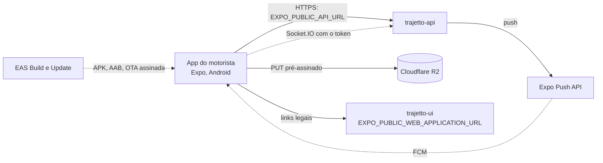

# Trajetto — App do motorista

<p align="center">
  
  
  
  
  
  
  
  
  
  
  
  
  
  
  
</p>

Aplicativo de campo do Trajetto, **só Android**, feito com Expo e React
Native. É o que o motorista usa no dia a dia: rota do dia, chegada, comprovante
de entrega com foto e assinatura, ocorrências, pausas, "a caminho", chat com a
central e, quando a empresa tem o módulo Frotas, abastecimentos e checklists do
veículo. Funciona sem sinal: o que o motorista registra fica no aparelho e é
enviado quando a rede volta.

> Software proprietário. Leia [Licença](#licença) antes de copiar qualquer coisa
> deste repositório.

## Sumário

- [Documentação](#documentação)
- [O Trajetto em 1 minuto](#o-trajetto-em-1-minuto)
- [Fronteiras deste repositório](#fronteiras-deste-repositório)
- [Onde o app fica na arquitetura](#onde-o-app-fica-na-arquitetura)
- [O que o app faz](#o-que-o-app-faz)
- [Stack e por que cada peça](#stack-e-por-que-cada-peça)
- [Como o código está organizado](#como-o-código-está-organizado)
- [Rodando localmente](#rodando-localmente)
- [Depuração](#depuração)
- [Variáveis de ambiente](#variáveis-de-ambiente)
- [Scripts](#scripts)
- [Sessão, empresa e módulos](#sessão-empresa-e-módulos)
- [Integrações](#integrações)
- [Offline: cache e fila de envios](#offline-cache-e-fila-de-envios)
- [Padrões para escrever código](#padrões-para-escrever-código)
- [Testes](#testes)
- [Build, publicação e fluxo de branches](#build-publicação-e-fluxo-de-branches)
- [Desenvolvimento, staging e produção](#desenvolvimento-staging-e-produção)
- [Solução de problemas](#solução-de-problemas)
- [Decisões e limites conhecidos](#decisões-e-limites-conhecidos)
- [Licença](#licença)

## Documentação

| Documento                                                        | O que tem                                                                                                                                                           |
| ---------------------------------------------------------------- | ------------------------------------------------------------------------------------------------------------------------------------------------------------------- |
| [`docs/arquitetura.md`](docs/arquitetura.md)                     | como o app é montado: offline (cache e fila), formulários, sessão e módulos, tempo real, rastreamento, contrato com a API, pré-checagem, tema, manifesto e decisões |
| [`docs/testes.md`](docs/testes.md)                               | suítes (Vitest, cobertura, mutação, Maestro no emulador), o que cada uma prova e as regras para escrever testes                                                     |
| [`docs/deploy.md`](docs/deploy.md)                               | perfis do EAS, staging e produção, pipeline, OTA assinada, Play Store, tamanho do app, Firebase, rollback e checklist do primeiro release                           |
| [`docs/variaveis-de-ambiente.md`](docs/variaveis-de-ambiente.md) | cada variável, secret e credencial: para quê, formato, valor por ambiente e onde configurar                                                                         |
| [`CLAUDE.md`](CLAUDE.md) / [`AGENTS.md`](AGENTS.md)              | guia para agentes de código (e para quem chega agora): comandos, convenções e o que não fazer                                                                       |

A arquitetura da plataforma inteira (web, app, API, Postgres, Redis, IA, R2,
provedores e deploy) fica documentada na API:

- [mapa da arquitetura](https://github.com/Trajetto-Organization/trajetto-api/blob/staging/docs/arquitetura.md)
  (`trajetto-api/docs/arquitetura.md`), com a
  [visão de componentes](https://github.com/Trajetto-Organization/trajetto-api/blob/staging/docs/arquitetura.md#vis%C3%A3o-de-componentes)
  navegável e a tabela de componentes e relações;
- [tour pela arquitetura](https://github.com/Trajetto-Organization/trajetto-api/blob/staging/docs/arquitetura-tour.md)
  (`trajetto-api/docs/arquitetura-tour.md`), que percorre a plataforma um
  assunto por vez, com os links ◀ Anterior e Próximo ▶ e o mesmo mapa aceso
  nas peças de cada passo;
- [mapa da infraestrutura](https://github.com/Trajetto-Organization/trajetto-api/blob/staging/docs/infraestrutura.md)
  (`trajetto-api/docs/infraestrutura.md`), com o que foi configurado à mão
  fora do código (Expo, GitHub, Cloudflare, Dokploy, Contabo, Resend e R2),
  os tokens e o porquê de cada escolha.

## O Trajetto em 1 minuto

O Trajetto é uma plataforma B2B (SaaS multiempresa) para transportadoras, com
dois módulos vendidos separadamente por empresa: **Frotas** (veículos,
abastecimentos, checklists, manutenção, multas, contas a pagar) e **Entregas**
(documentos, rotas, torre de controle, ocorrências, comprovantes, atendimento
com o motorista, integrações).

| Repositório no GitHub (pasta local)         | O que é                                                                                        | Onde roda                                                                          |
| ------------------------------------------- | ---------------------------------------------------------------------------------------------- | ---------------------------------------------------------------------------------- |
| `trajetto-api`                              | API (Fastify, Prisma, PostgreSQL, Redis), tempo real, filas, crons e o serviço local de IA/OCR | Dokploy: Applications `trajetto-api` e `trajetto-ai`, Databases PostgreSQL e Redis |
| `trajetto-ui` (`trajetto-ui`)               | painel web e site público (Next.js)                                                            | Dokploy, Application `trajetto-ui`                                                 |
| `trajetto-mobile` (`trajetto-mobile`, este) | app do motorista, só Android                                                                   | EAS (APK interno e Play Store)                                                     |

## Fronteiras deste repositório

- **A API é o juiz de todas as regras.** O app decide o que mostrar (módulos,
  perfil) e valida antes de enviar, mas a API recusa o que não pode.
- Só Android. Não há build iOS nem versão web deste app; o motorista no
  navegador usa o `/driver` da `trajetto-ui`.
- O app não vai para o Dokploy nem para o GHCR: é distribuído pelo EAS (APK e
  AAB) e atualizado por OTA (EAS Update).
- Não há exportação de arquivos no app: CSV e Excel são do painel web.

## Onde o app fica na arquitetura



No GitHub, o diagrama tem os controles de zoom e de deslocamento, e cada caixa
com link abre a seção que a explica.

## O que o app faz

O app mostra só o que o módulo contratado e o perfil do usuário permitem: um
motorista de empresa sem Frotas não vê veículo, abastecimento nem checklist.

### Entregas (módulo Entregas)

- **Dia do motorista:** as rotas liberadas ou em andamento e suas paradas, na
  ordem definida pela central.
- **Iniciar rota, chegada e "a caminho":** cada toque vira um evento da
  entrega, com horário e GPS; "a caminho" aparece na torre e pode avisar o
  cliente, se a empresa tiver mensagem ativa para isso.
- **Comprovante de entrega:** é o registro de uma ocorrência da categoria
  entrega. O tipo escolhido define o que é exigido: foto do canhoto (só pela
  câmera), assinatura na tela, fotos extras, formulário e quem recebeu.
- **Ocorrências** (não entrega): o tipo pode exigir foto, formulário com campos
  obrigatórios (validados no aparelho, inclusive offline) e autorização da
  torre. Enquanto a torre não responde, a entrega fica aguardando; a resposta
  chega em tempo real e por push.
- **Pausas** (refeição, descanso e outros tipos da empresa): só dentro de uma
  jornada, isto é, com rota liberada ou em andamento no dia.
- **Pré-checagem no aparelho:** quando a empresa contratou a IA, o app lê o
  canhoto e o odômetro no próprio celular (ML Kit, sem rede) e avisa se o
  número da NF, a data ou a km não batem. É só sugestão: o motorista pode
  enviar mesmo assim e o servidor faz a leitura oficial.

### Chat (atendimento)

Conversa com a central organizada por ticket: cada assunto (uma ocorrência,
uma entrega, uma rota ou um assunto geral) tem histórico e status. O app envia
texto, imagem e áudio gravado, e mostra quando a central leu.

### Frotas (módulo Frotas)

- **Abastecimento:** foto do odômetro, km, litros, valor e a posição no momento
  do envio.
- **Checklist veicular:** itens com fotos obrigatórias e a km do veículo.
- Valem para o veículo em que o motorista é responsável fixo e para o veículo
  da rota liberada ou em andamento.

### Conta

Login com verificação em duas etapas, escolha de empresa (só para o MASTER),
notificações, envios pendentes e links para Privacidade e Termos.

### Rastreamento de posição

Com o app aberto, o app envia a posição do motorista durante a rota e a torre
mostra o veículo. O rastreamento com a tela desligada está pronto e testado,
mas **desligado** (`EXPO_PUBLIC_BACKGROUND_TRACKING=false`) até a declaração de
localização em segundo plano ser aprovada no Play Console. Permissões do build
padrão: câmera, localização precisa e aproximada e microfone (áudio do chat).

## Stack e por que cada peça

Versões instaladas pelo `package-lock.json`.

| Peça                                                        | Versão                     | Por que está aqui                                                                                 |
| ----------------------------------------------------------- | -------------------------- | ------------------------------------------------------------------------------------------------- |
| Expo SDK com **dev client**                                 | 54.0.37                    | toolchain, módulos nativos alinhados ao SDK e EAS; o Expo Go não serve (há módulo nativo próprio) |
| React Native (nova arquitetura, Hermes, React Compiler)     | 0.81.5                     | base do app                                                                                       |
| React                                                       | 19.1.0                     | base do React Native 0.81                                                                         |
| expo-router                                                 | 6.0.24                     | rotas por arquivo em `app/` (grupos `(auth)` e `(protected)`)                                     |
| NativeWind + Tailwind                                       | 4.2.1 / 3.4.17             | estilo por classes com os tokens de tema claro e escuro                                           |
| `@tanstack/react-query` + persistência no AsyncStorage      | 5.89.0                     | cache de leitura que sobrevive offline por 7 dias                                                 |
| zustand                                                     | 5.0.8                      | sessão, conexão, fila de envios e atualização obrigatória                                         |
| react-hook-form + zod                                       | 7.62.0 / 3.25.76           | formulários com esquemas espelhados da API e validação ao vivo                                    |
| socket.io-client                                            | 4.8.3                      | tempo real (rota, decisões da torre, chat, catálogos)                                             |
| expo-notifications                                          | 0.32.17                    | token de push e toque na notificação                                                              |
| expo-secure-store                                           | 15.0.8                     | tokens de sessão fora do AsyncStorage                                                             |
| expo-location + expo-task-manager                           | 19.0.8 / 14.0.9            | posição durante a rota                                                                            |
| expo-image-picker, expo-image-manipulator, expo-file-system | 17.0.11 / 14.0.8 / 19.0.24 | câmera, re-encode (tira EXIF e GPS) e cópia das fotos para a fila                                 |
| expo-updates                                                | 29.0.20                    | OTA assinada, runtime por fingerprint                                                             |
| `modules/text-reader` (Kotlin, ML Kit)                      | próprio                    | OCR no aparelho para a pré-checagem                                                               |
| TypeScript                                                  | 5.9.2                      | tipos; `npm run typecheck`                                                                        |
| Vitest, Stryker                                             | 1.6.0 / 8.7.1              | testes unitários em Node puro e mutação nas regras                                                |
| Maestro                                                     | fora do `package.json`     | E2E no emulador                                                                                   |
| npm                                                         | `package-lock.json`        | gerenciador de pacotes deste repositório (não Yarn)                                               |

## Como o código está organizado

```
app/                    rotas expo-router: (auth)/ login, 2FA, senha;
                        (protected)/ telas logadas; (tabs)/ vehicles, deliveries, chat
features/<assunto>/     regras puras (*-rules.ts) + hooks do assunto
  submissions/          fila offline (outbox), rascunhos, wizard, submit-or-queue
  offline/              allowlist do cache persistido
  access/               módulos contratados (FLEET, DELIVERIES)
  forms/                validação ao vivo, resolver de km, foco
  ai-precheck/          pré-checagem das fotos no aparelho (ML Kit)
  app-update/           tela de atualização obrigatória (426)
  tracking/             rastreamento de posição
  deliveries, occurrences, pauses, chat, fuel, checklist, notifications, …
components/ui/          peças compartilhadas, já em tokens de tema
components/screens/     componentes de cada tela
hooks/ providers/ store/  hooks transversais, provedores, stores zustand
schemas/                zod espelhando os contratos da API
utils/                  api.ts, api-url-rules.ts, client-version.ts, storage.ts, telemetry.ts
modules/text-reader/    módulo nativo Kotlin (OCR no aparelho)
plugins/                config plugins (ABIs dos APKs, uiMode)
tests/unitaires/        testes Vitest; tests/fixtures/ dados
.maestro/ scripts/e2e/  E2E no emulador
app.json app.config.js eas.json  configuração Expo/EAS
```

Alias `@/` = raiz do repositório. Regra de negócio vive em funções puras
(`features/**/*-rules.ts`) sem import de React nem de módulo nativo, testadas
em Node puro; as telas compõem hooks focados (não há contexto global de
formulário, de propósito). As regras completas estão no [`CLAUDE.md`](CLAUDE.md).

## Rodando localmente

### Pré-requisitos

- Node.js 22 e npm (o repositório usa `package-lock.json`);
- conta no expo.dev, membro da organização `trajetto` (papel _Viewer_ por
  padrão: o bastante para baixar o dev client; ver o passo 3);
- um aparelho Android ou um emulador do Android Studio;
- a API rodando (README do `trajetto-api`); para os testes de paridade, o
  `trajetto-api` clonado ao lado deste repositório.

### Passo a passo

```bash
# 1. Dependências (exatamente as do lockfile)
npm ci

# 2. Variáveis locais (só o Metro lê este arquivo; o EAS não)
cp .env.example .env
#    num aparelho físico, troque localhost pelo IP da sua máquina na rede;
#    no emulador, http://10.0.2.2:3333 chega à API do computador

# 3. Instale o dev client uma vez (o Expo Go não serve): baixe o APK do
#    build "development" mais recente em expo.dev → projeto → Builds

# 4. Suba o Metro e abra o app de desenvolvimento no aparelho
npm start
```

**Quem gera o dev client.** Gerar build no EAS pede o papel _Developer_ na
organização da Expo, e quem tem esse papel também consegue publicar OTA em
produção pela própria máquina (os binários de produção aceitam update sem
assinatura). Por isso um dev novo entra como _Viewer_, que só vê e baixa os
builds, e o dev client é gerado por quem tem _Developer_ (hoje, o dono):

```bash
npm install -g eas-cli@21.7.0   # a versão do eas.json
eas login
npm run build:development       # gera o APK de desenvolvimento no EAS
```

Um dev client novo só é preciso quando o lado nativo muda (dependência
nativa, `app.config.js`, plugin); mudança de código chega pelo Metro. Quem
gera avisa a equipe, e cada um baixa o APK novo na página do build.

Faça login com um usuário motorista criado no painel web (cadastro de
motorista vinculado a um usuário). Gerar o APK de desenvolvimento localmente
(`npx expo prebuild` + Gradle) também funciona, mas deixa a pasta `android/`
no disco, que precisa ser apagada depois (o `android-manifest.test.ts` falha
com ela).

## Depuração

### Dev client ou release

O Hermes é o motor JS dos dois (`jsEngine: "hermes"` no `app.json`); o resto
muda bastante:

|                                                 | Build de desenvolvimento (perfil `development`)      | Release (`preview`, `staging`, `production`)                                                     |
| ----------------------------------------------- | ---------------------------------------------------- | ------------------------------------------------------------------------------------------------ |
| De onde vem o JS                                | do Metro, na hora; salvar um arquivo atualiza a tela | embutido no binário, já compilado para bytecode do Hermes; muda por OTA do canal ou binário novo |
| Menu de desenvolvimento e React Native DevTools | sim                                                  | não                                                                                              |
| Logs                                            | terminal do Metro, DevTools e `adb logcat`           | só `adb logcat`                                                                                  |
| Ler os arquivos do app pelo `adb` (`run-as`)    | sim, o build é depurável                             | não                                                                                              |
| Binário                                         | build debug, quatro ABIs, sem R8                     | APK com duas ABIs (`preview`, `staging`) ou AAB (`production`), com R8 e `shrinkResources`       |

### Depurar o JavaScript (dev client)

```bash
npm start        # Metro; abra o app de desenvolvimento no aparelho
npm run clear    # o mesmo, limpando o cache do Metro (use depois de mudar o .env)
```

- `j` no terminal do Metro abre o React Native DevTools ligado ao Hermes do
  aparelho: console, fontes com pontos de parada e memória.
- `m` no terminal, chacoalhar o aparelho ou `adb shell input keyevent 82`
  abrem o menu de desenvolvimento (recarregar, abrir o DevTools, monitor de
  desempenho).
- Aparelho no USB: `adb reverse tcp:8081 tcp:8081` leva o aparelho ao Metro, e
  `adb reverse tcp:3333 tcp:3333` faz o `http://localhost:3333` do `.env`
  chegar à API do computador.

### Logs (`adb logcat`)

```bash
adb logcat -s ReactNativeJS:V ReactNative:V                       # console do JS e avisos do React Native
adb logcat --pid=$(adb shell pidof -s com.trajetto.fleetmanager)  # só o processo do app
adb logcat -b crash                                               # quedas nativas
```

- Valem também no release: o `console` do JS sai no logcat com a tag
  `ReactNativeJS`.
- `logger.dev` só escreve em desenvolvimento (`__DEV__`); `logger.info` e
  `logger.error` escrevem sempre, sem dados pessoais (`utils/logger.ts`).
  Posições e textos do motorista ficam fora do log
  (`tracking-log-privacy.test.ts`).
- Falhas que só o aparelho vê (foto recusada pelo R2, fila presa) chegam à
  API: com sessão válida, o app manda um resumo para `POST /diagnostics/client`,
  no máximo um a cada 5 minutos, e ele vira uma linha `client.diagnostics` no
  log da API, com usuário, empresa e o resumo da fila (`features/diagnostics/`).

### Apontar para o staging

- **APK de staging**: já aponta para `https://api-staging.intrajetto.com`,
  porque a URL é embutida no build pelo ambiente EAS `preview`. Baixe o APK
  do build no expo.dev e instale com `adb install -r <arquivo>.apk`. Ele
  recebe as OTAs do canal `staging`.
- **Dev client contra a API de staging**: no `.env`,
  `EXPO_PUBLIC_API_URL=https://api-staging.intrajetto.com` e
  `EXPO_PUBLIC_WEB_APPLICATION_URL=https://staging.intrajetto.com/login`;
  depois `npm run clear`, porque as `EXPO_PUBLIC_*` são embutidas no bundle.
  Entre com um usuário do staging e volte o `.env` para o local ao terminar.
- O dev client, o APK de staging e o de produção usam o mesmo pacote
  (`com.trajetto.fleetmanager`): instalar um substitui o outro. Se o Android
  recusar por assinatura diferente, desinstalar apaga a fila de envios e o
  cache do aparelho: mande os pendentes antes.

### Fila de envios e cache offline

- **No app**: a tela **Envios pendentes** (toque no aviso da fila, que
  aparece no topo quando há itens, ou no aviso do logout) mostra cada item
  com o estado e o motivo, e permite enviar agora, revisar ou descartar.
- **No disco**, só no build de desenvolvimento (o `run-as` exige um build
  depurável). A fila e o cache ficam no AsyncStorage, um SQLite chamado
  `RKStorage`; os tokens ficam no SecureStore, fora dele. Os arquivos têm
  dados do motorista: não compartilhe e apague depois.

  ```bash
  for f in RKStorage RKStorage-wal; do
    adb exec-out run-as com.trajetto.fleetmanager cat databases/$f > $f
  done
  sqlite3 RKStorage "select key, length(value) from catalystLocalStorage order by key;"
  sqlite3 RKStorage "select value from catalystLocalStorage where key = '@trajetto:outbox:v1';"
  ```

  | Chave                               | O que guarda                                                               |
  | ----------------------------------- | -------------------------------------------------------------------------- |
  | `@trajetto:outbox:v1`               | a fila de envios (`features/submissions/outbox.ts`)                        |
  | `@trajetto:react-query:offline-v1`  | o cache de leitura, até 7 dias (`providers/query-provider.tsx`)            |
  | `@trajetto:submission:…`            | rascunhos dos formulários e os ids de envio (`client_submission_id`)       |
  | `@trajetto:driver-pause:v1` e afins | estado persistido das pausas, do "a caminho" e do retorno dos comprovantes |

## Variáveis de ambiente

| Variável                          | Onde                                                     | Para quê                                                                     | Exemplo seguro                |
| --------------------------------- | -------------------------------------------------------- | ---------------------------------------------------------------------------- | ----------------------------- |
| `EXPO_PUBLIC_API_URL`             | `.env` local e ambientes EAS                             | base das chamadas REST e do Socket.IO; em release, só HTTPS público          | `http://localhost:3333`       |
| `EXPO_PUBLIC_WEB_APPLICATION_URL` | `.env` local e ambientes EAS                             | botão do painel web e base dos links de Privacidade e Termos                 | `http://localhost:3000/login` |
| `EXPO_PUBLIC_BACKGROUND_TRACKING` | `.env` local e ambientes EAS                             | `false` até a aprovação no Play Console; muda o manifesto (exige build novo) | `false`                       |
| `APP_ENV`                         | só nos ambientes EAS                                     | nome do ambiente, para a checagem de URL também no `eas update`              | `preview` ou `production`     |
| `GOOGLE_SERVICES_JSON`            | só nos ambientes EAS (variável do tipo arquivo, secreta) | configuração Android do Firebase; sem ela o app nunca recebe push            | —                             |
| `EXPO_TOKEN`                      | secret do repositório no GitHub                          | publicar no EAS pelo CI                                                      | —                             |
| `EXPO_UPDATE_PRIVATE_KEY`         | secret dos environments `staging` e `production`         | assinar as OTAs                                                              | —                             |
| `API_REPO_READ_TOKEN`             | secret do repositório no GitHub                          | checkout da API para os testes de paridade no CI                             | —                             |
| `PLAY_SUBMIT_ENABLED`             | variável do repositório no GitHub                        | `true` envia o AAB de produção à trilha internal                             | `false`                       |

**O EAS não lê o `.env`.** `eas build` e `eas update` usam as variáveis do
ambiente EAS indicado no `eas.json` (`development`, `preview` ou
`production`; o perfil `staging` usa o `preview`). As `EXPO_PUBLIC_*` são
embutidas no bundle em tempo de build e ficam legíveis no APK: não são
segredo e não há configuração em tempo de execução. Variável `EXPO_PUBLIC_*`
nova entra no `.env.example` (um teste exige) e em
[`docs/variaveis-de-ambiente.md`](docs/variaveis-de-ambiente.md), que tem os
valores por ambiente e o passo a passo do `eas env:create`.

## Scripts

Todos conferidos no `package.json`.

| Script                                                                               | O que faz                                                       |
| ------------------------------------------------------------------------------------ | --------------------------------------------------------------- |
| `npm start`                                                                          | Metro (`expo start`); abre no dev client                        |
| `npm run android`                                                                    | Metro e abre no Android                                         |
| `npm run clear`                                                                      | Metro limpando o cache                                          |
| `npm run typecheck`                                                                  | `tsc --noEmit`                                                  |
| `npm run lint`                                                                       | `expo lint`                                                     |
| `npm test`                                                                           | testes unitários (Vitest, `tests/unitaires`)                    |
| `npm run test:watch`                                                                 | unitários em modo watch                                         |
| `npm run test:coverage`                                                              | unitários com cobertura e piso                                  |
| `npm run test:mutation`                                                              | teste de mutação (Stryker)                                      |
| `npm run doctor`                                                                     | `expo-doctor`                                                   |
| `npm run validate`                                                                   | typecheck, testes, lint e doctor                                |
| `npm run build:development` / `build:preview` / `build:staging` / `build:production` | builds Android no EAS                                           |
| `npm run submit:android`                                                             | envia o build de produção à Play Store (trilha `internal`)      |
| `npm run update:preview` / `update:staging` / `update:production`                    | publica OTA no canal (passe a mensagem no fim: `-- "mensagem"`) |
| `npm run codesigning:generate`                                                       | gera o par de chaves e o certificado das OTAs                   |
| `npm run eas:login` / `npm run expo:login`                                           | login nas contas                                                |

Antes de entregar uma mudança: `npm run typecheck` e `npm test` (ou
`npx vitest run tests/unitaires/<arquivo>.test.ts`). Builds e OTAs só com
pedido explícito.

## Sessão, empresa e módulos

- **Login** com e-mail e senha (`POST /user/session`) e, quando a conta exige,
  verificação em duas etapas (`app/(auth)/two-factor.tsx`,
  `POST /user/two-factor-verification`); recuperação de senha.
- **Tokens** no SecureStore (`utils/storage.ts`); cache, fila e preferências
  no AsyncStorage. O refresh (`POST /user/refresh-token`) é _single-flight_:
  várias requisições com token vencido disparam um refresh só.
- **Empresa**: o motorista pertence a uma empresa, e a API tira a empresa do
  token. O MASTER, que não tem empresa, escolhe uma na tela
  `select-business`.
- **Módulos** (`features/access/module-rules.ts`): `FLEET` e `DELIVERIES`
  decidem abas, cartão do veículo, telas de abastecimento e checklist, a tela
  de entrada e a fila. A API continua barrando com `403 MODULE_NOT_ENABLED`.
- **Logout com envios pendentes** avisa; os itens da fila pertencem ao dono e
  nunca são enviados em nome de outro usuário no mesmo aparelho. Encerramento
  remoto da sessão desloga e limpa os stores.

## Integrações

| Integração                 | Para quê                                                                          | Onde                                                           |
| -------------------------- | --------------------------------------------------------------------------------- | -------------------------------------------------------------- |
| `trajetto-api` (HTTP)      | todos os dados e envios; cabeçalho `x-trajetto-client-version` em toda requisição | `utils/api.ts`, `utils/client-version.ts`                      |
| `trajetto-api` (Socket.IO) | mudança de rota, decisão da torre, chat, catálogos, acesso                        | `providers/socket-provider.tsx`                                |
| Cloudflare R2              | fotos por PUT pré-assinado, com upload retomável                                  | `features/media/use-image-capture.ts`, `features/submissions/` |
| Expo Push → FCM            | push; o app registra o token Expo na API                                          | `utils/push-token.ts`, `google-services.json` no build         |
| EAS Build e Update         | binários e OTA assinada                                                           | `eas.json`, `.github/workflows/deploy.yml`                     |
| ML Kit (no aparelho)       | pré-checagem das fotos, sem rede                                                  | `modules/text-reader/`, `features/ai-precheck/`                |
| painel web                 | links legais e botão "abrir a plataforma web"                                     | `EXPO_PUBLIC_WEB_APPLICATION_URL`                              |

O app não guarda segredo de provedor: a API envia o push pela Expo Push API,
que repassa ao FCM com a credencial do projeto EAS.

## Offline: cache e fila de envios

- **Cache de leitura:** o react-query persiste o dia do motorista e os
  catálogos por até 7 dias (`providers/query-provider.tsx`); só as chaves de
  `OFFLINE_QUERY_KEYS` (`features/offline/offline-cache-rules.ts`). Sem rede,
  o app abre com o último dia baixado.
- **Fila de envios (outbox):** chegada, comprovante, ocorrência, pausa,
  abastecimento e checklist vão para uma fila durável
  (`features/submissions/`). Cada item tem um `client_submission_id`, então
  reenviar nunca duplica no servidor. Só falha transitória vai para a fila;
  erro de regra fica na tela com o rascunho.
- **Rascunhos:** os formulários longos salvam o que foi digitado; se o app
  fechar ou o sinal cair, nada se perde.
- **Recusas:** um item que o servidor recusa por regra espera a revisão do
  motorista em "Envios pendentes", sem perder foto, assinatura, horário e
  local.
- "API parece inacessível" nunca pausa a fila; só o rádio desligado.

## Padrões para escrever código

- **Funcionalidade nova** (passo a passo no [`CLAUDE.md`](CLAUDE.md)): o
  contrato na API primeiro; o esquema em `schemas/<assunto>.ts` (zod); a regra
  pura em `features/<assunto>/<assunto>-rules.ts` com teste; o tipo na fila,
  se precisar funcionar offline; o hook em `features/<assunto>/` e a tela em
  `app/(protected)/` com componentes em `components/screens/`, tokens de tema
  e `testID`; suba `CLIENT_CONTRACT` (`utils/client-version.ts`) se o app
  passou a enviar algo novo.
- **Validação**: zod + react-hook-form, com validação ao vivo
  (`features/forms/live-validation.ts`): confere ao sair do campo, some na
  tecla que corrige; o envio foca o primeiro inválido.
- **Erros**: `utils/api-error.ts` classifica em transitório (rede, 5xx, 429),
  permanente (regra de negócio), autenticação, contrato (426) e "API
  inacessível"; a classificação decide se um envio vai para a fila.
- **Cache**: só a allowlist offline; `gcTime` acompanha o `maxAge` de 7 dias.
- **Uploads**: toda foto passa por `prepareUploadImage` dentro de
  `use-image-capture` (re-encode que remove EXIF e GPS, nunca condicional) e
  sobe por URL pré-assinada; a API recebe só as chaves.
- **Contrato com a API**: mudou rota, campo ou formato de upload, suba
  `CLIENT_CONTRACT`; mudou o formato de um item da fila, suba
  `OUTBOX_SCHEMA_VERSION` e acrescente o passo em `upcastOutboxItem`.
- **Tema**: só tokens (`bg-background`, `text-ink`…); nada de `gray-*`, hex
  ou `bg-white`.

## Testes

| Suíte                                               | Onde                        | Como rodar                                                 | Precisa de                                                                    |
| --------------------------------------------------- | --------------------------- | ---------------------------------------------------------- | ----------------------------------------------------------------------------- |
| Unitários (regras puras, hooks, contratos, configs) | `tests/unitaires`           | `npm test`                                                 | só Node                                                                       |
| Cobertura com piso                                  | `vitest.config.ts`          | `npm run test:coverage`                                    | só Node                                                                       |
| Mutação                                             | `stryker.config.mjs`        | `npm run test:mutation`                                    | só Node (lento)                                                               |
| E2E no emulador (Maestro)                           | `.maestro/`, `scripts/e2e/` | [`docs/testes.md`](docs/testes.md#e2e-no-emulador-maestro) | emulador Android, Maestro, API (porta 3335) e banco `mobile_e2e` descartáveis |

```bash
npm test                                                  # todos os unitários (Vitest, tests/unitaires)
npx vitest run tests/unitaires/outbox-rules.test.ts       # um arquivo
npx vitest run tests/unitaires/outbox-rules.test.ts -t "trecho do nome"   # só os casos com esse nome
npm run test:watch                                        # modo watch
npm run test:coverage                                     # com cobertura e o piso
npm run test:mutation                                     # mutação (Stryker), lento
npm run typecheck                                         # tsc --noEmit
npm run validate                                          # typecheck, testes, lint e expo-doctor, em sequência
```

O piso de cobertura está em `vitest.config.ts` (suba quando a cobertura subir,
nunca baixe). Os testes de paridade leem `../trajetto-api` e se pulam sem ele.
O E2E dirige o app de verdade no emulador (scripts Bash em `scripts/e2e/`,
Git Bash no Windows) e roda só localmente, nunca no CI. Passo a passo, massa de
dados e armadilhas em [`docs/testes.md`](docs/testes.md).

## Build, publicação e fluxo de branches

```
branch de trabalho ──PR──► staging ──PR (merge commit)──► main
```

| Onde                                                      | O que acontece (`.github/workflows/`)                                                                                                                                                                                                                            |
| --------------------------------------------------------- | ---------------------------------------------------------------------------------------------------------------------------------------------------------------------------------------------------------------------------------------------------------------- |
| push numa branch de trabalho, PR para `staging` ou `main` | `ci.yml`: audit, lint, typecheck, unitários com piso de cobertura, `expo-doctor` e gitleaks                                                                                                                                                                      |
| push em `staging`                                         | `deploy.yml`: CI completo → OTA no canal `staging` e, se o lado nativo mudou, APK de staging no EAS                                                                                                                                                              |
| push em `main`                                            | `deploy.yml`: CI completo → prova de que o commit ficou verde em `staging` → aprovação do ambiente `production` → OTA **assinada** no canal `production` e, se o lado nativo mudou, AAB de produção (enviado à trilha `internal` com `PLAY_SUBMIT_ENABLED=true`) |
| manual                                                    | `deploy.yml` (build de qualquer perfil) e `ota-rollback.yml` (republica um grupo de OTA anterior do mesmo canal)                                                                                                                                                 |

| Perfil (`eas.json`) | Ambiente EAS  | Canal         | Artefato                      | Para quê                              |
| ------------------- | ------------- | ------------- | ----------------------------- | ------------------------------------- |
| `development`       | `development` | `development` | APK com dev client            | desenvolvimento e E2E                 |
| `preview`           | `preview`     | `preview`     | APK                           | testes internos                       |
| `staging`           | `preview`     | `staging`     | APK                           | homologação contra a stack de staging |
| `production`        | `production`  | `production`  | AAB, `versionCode` automático | Play Store                            |

- Como as `EXPO_PUBLIC_*` são embutidas no build, o que se promove de staging
  para produção é o **commit**, não o artefato.
- O runtime é calculado por _fingerprint_: uma OTA só chega a binários com o
  mesmo código nativo; mudança nativa exige build novo.
- Sem o secret `EXPO_TOKEN`, os jobs de publicação terminam com um aviso e
  não publicam nada.
- Tamanho: o APK de staging medido (release, duas ABIs) tem 75,1 MB; a
  composição, a estimativa do AAB por ABI e as reduções possíveis estão em
  [`docs/deploy.md` → Tamanho do app](docs/deploy.md#tamanho-do-app).
- Guia completo (OTA assinada, Play Store, Firebase, gate de versão, rollback
  e checklist do primeiro release): [`docs/deploy.md`](docs/deploy.md). A
  seção "Os três repositórios juntos" (igual nos três repositórios) traz a
  ordem do primeiro deploy, a ordem de cada release (**API → web → app**), os
  endereços e os valores que precisam casar com a API e a web.

## Desenvolvimento, staging e produção

|                                   | Desenvolvimento                                            | Staging                                | Produção                                          |
| --------------------------------- | ---------------------------------------------------------- | -------------------------------------- | ------------------------------------------------- |
| `EXPO_PUBLIC_API_URL`             | `http://localhost:3333` (emulador: `http://10.0.2.2:3333`) | `https://api-staging.intrajetto.com`   | a definir (previsto `https://api.intrajetto.com`) |
| `EXPO_PUBLIC_WEB_APPLICATION_URL` | `http://localhost:3000/login`                              | `https://staging.intrajetto.com/login` | `https://www.intrajetto.com/login`                |
| ambiente EAS / canal              | `development` / `development`                              | `preview` / `staging`                  | `production` / `production`                       |
| artefato                          | APK com dev client                                         | APK instalado à mão                    | AAB na Play Store                                 |
| URL da API                        | qualquer (checagem relaxada)                               | só HTTPS público                       | só HTTPS público                                  |
| OTA                               | —                                                          | assinada quando há chave               | sempre assinada, após aprovação                   |

Um build de release recusa `EXPO_PUBLIC_API_URL` sem HTTPS, com credenciais,
query ou fragmento, ou de rede local (`utils/api-url-rules.ts` e a cópia no
`app.config.js`). Os APKs de staging e de produção usam o mesmo pacote: um
substitui o outro no aparelho.

## Solução de problemas

| Sintoma                                                 | Causa provável                                                  | O que fazer                                                       |
| ------------------------------------------------------- | --------------------------------------------------------------- | ----------------------------------------------------------------- |
| "There was a problem loading the project" no dev client | bundle frio ou Metro inacessível                                | espere o primeiro bundle; confira `adb reverse tcp:8081 tcp:8081` |
| App não chega à API no aparelho físico                  | `localhost` aponta para o próprio celular                       | use o IP da máquina na rede ou um túnel HTTPS                     |
| Build de release diz "API inacessível"                  | `EXPO_PUBLIC_API_URL` sem HTTPS ou de rede local                | configure uma URL HTTPS pública no ambiente EAS                   |
| OTA publicada não chega ao app                          | runtime diferente (o código nativo mudou)                       | gere um build novo para aquele runtime                            |
| Push não chega                                          | build sem `GOOGLE_SERVICES_JSON` ou sem a credencial FCM no EAS | `docs/deploy.md` (Firebase e push)                                |
| Tela de atualização obrigatória                         | build abaixo de `MIN_MOBILE_CONTRACT` (variável da API)         | atualize pelo OTA oferecido ou pela loja                          |
| Itens presos em "Envios pendentes"                      | sem rede, ou recusa que espera revisão                          | abra o item e revise; com rede, a fila esvazia sozinha            |
| Pré-checagem nunca aparece                              | empresa sem IA contratada, ou build sem o módulo nativo         | é opcional; o envio funciona sem ela                              |
| `android-manifest.test.ts` falha depois do E2E          | pasta `android/` gerada pelo prebuild ficou no disco            | apague `android/`                                                 |

## Decisões e limites conhecidos

- **Só Android**, com dev client (sem Expo Go).
- **Rastreamento em segundo plano desligado** até a aprovação do Play Console
  (decisão 7.3); até lá, a torre só vê quem está com o app aberto.
- **Offline de verdade só no laço do motorista**; telas de consulta mostram o
  que estiver em cache.
- **Formulários sem contexto**, de propósito (re-render a cada tecla em
  Android de entrada).
- **Staging usa o ambiente EAS `preview`**: o plano do EAS não tem ambiente
  personalizado.
- **Promove-se o commit, não o artefato**, porque a URL da API é embutida no
  build.
- O host da API de produção ainda está a definir (previsto
  `api.intrajetto.com`).
- **APK de staging com 75,1 MB** (build `ef6c2390-…`); os ~96 MB vistos são,
  provavelmente, o tamanho instalado (APK mais os artefatos do ART), ainda não
  confirmado. O dev client leva ~9,7 MB de peso nativo aos builds de release;
  tirá-lo exige build novo e teste no aparelho
  ([`docs/deploy.md` → Tamanho do app](docs/deploy.md#tamanho-do-app)).

## Licença

Software proprietário da Trajetto, com todos os direitos reservados. O uso, a
cópia, a modificação e a distribuição dependem de autorização por escrito da
Trajetto. Os termos completos estão em [`LICENSE`](./LICENSE), os mesmos do
`trajetto-api`. O `package.json` declara `"license": "UNLICENSED"` e
`"private": true`.
